<div align="center">

# ⚡ Slotly

**A modern, production-grade multi-tenant booking and scheduling SaaS platform.**  
*A simplified Calendly for clinics, salons, and gyms with strict tenant isolation, zero-double-booking guarantees, and real-time availability updates.*

[](https://github.com/BenkacemIbrahim/.NET/actions/workflows/ci.yml)
[](https://github.com/BenkacemIbrahim/.NET/actions/workflows/codeql.yml)
[](LICENSE)
[](https://dotnet.microsoft.com/)
[](https://react.dev/)
[](https://www.docker.com/)

</div>

---

## 📸 Visual Showcase

<div align="center">

### Customer Booking Experience (Desktop Light & Dark)

| Light Theme | Dark Theme |
| :---: | :---: |
| 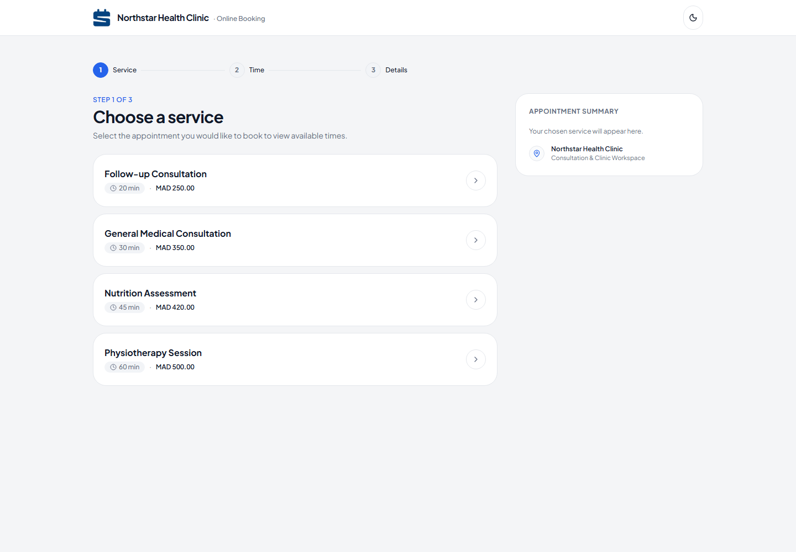 | 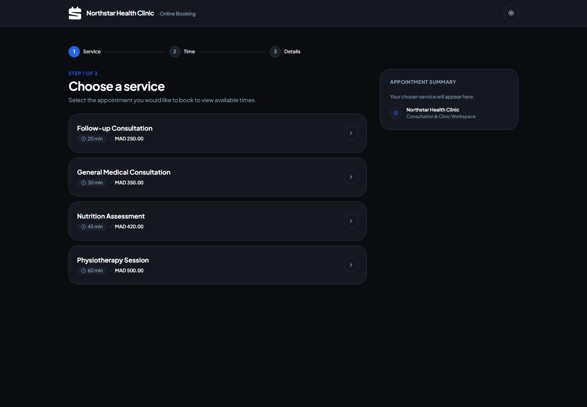 |

### Tenant Authentication & Workspace Sign-in (Desktop Light & Dark)

| Light Theme | Dark Theme |
| :---: | :---: |
| 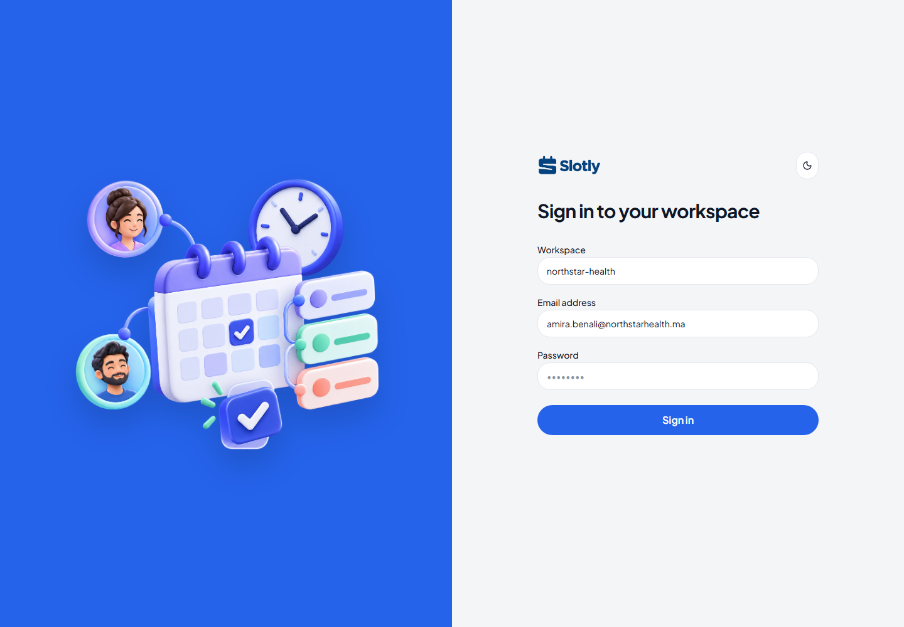 | 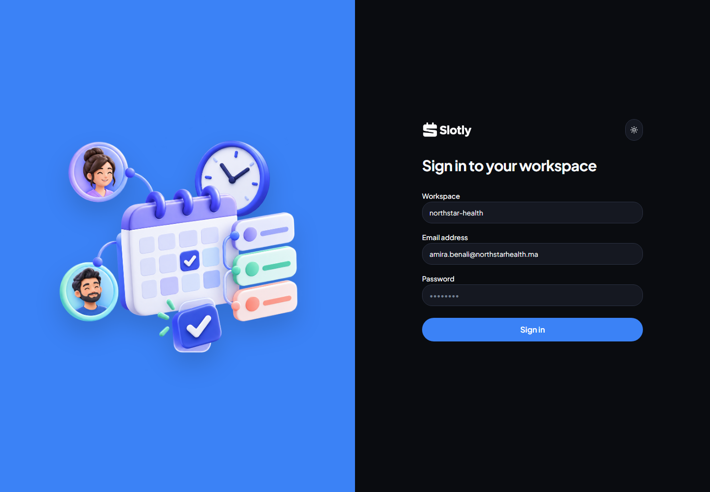 |

### Tenant Operations Dashboard (Desktop Light & Dark)

| Light Theme | Dark Theme |
| :---: | :---: |
| 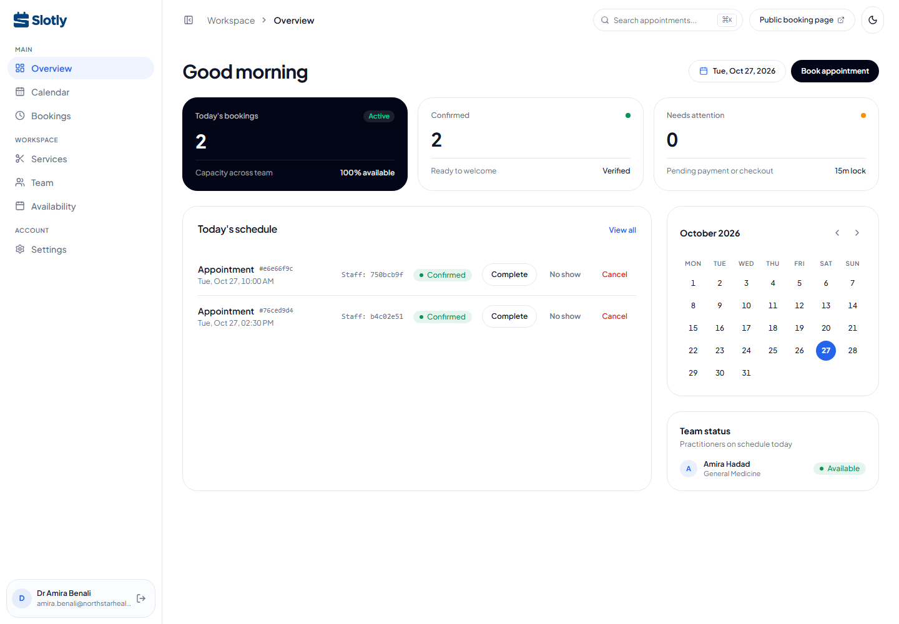 | 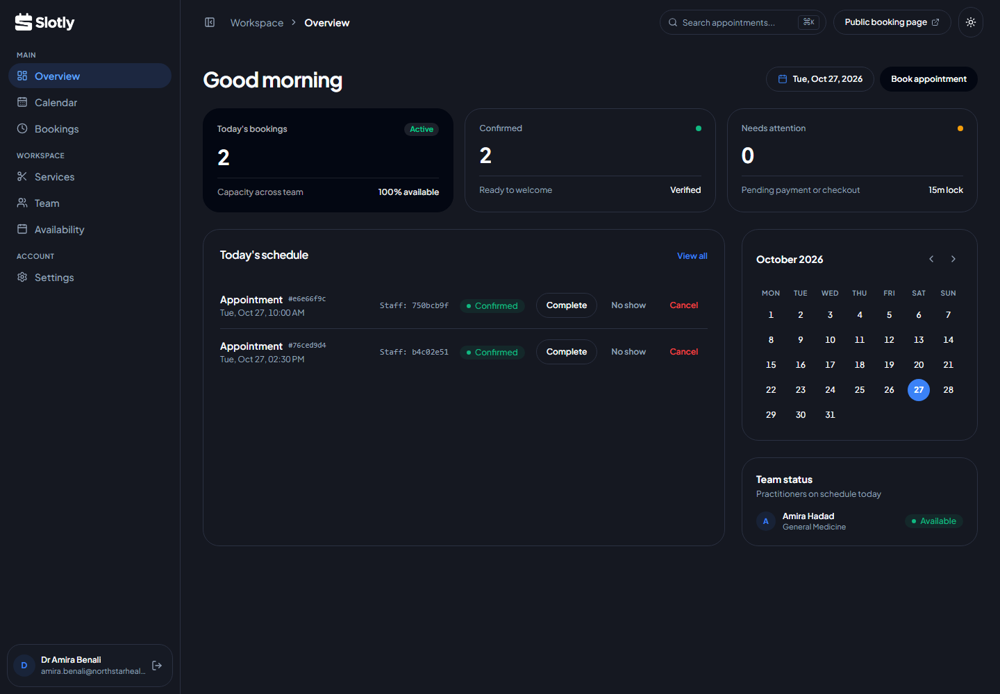 |

### Mobile-First Responsive Experience (390px Viewport)

| Mobile Customer Booking | Mobile Workspace Sign-in | Mobile Admin Operations |
| :---: | :---: | :---: |
| 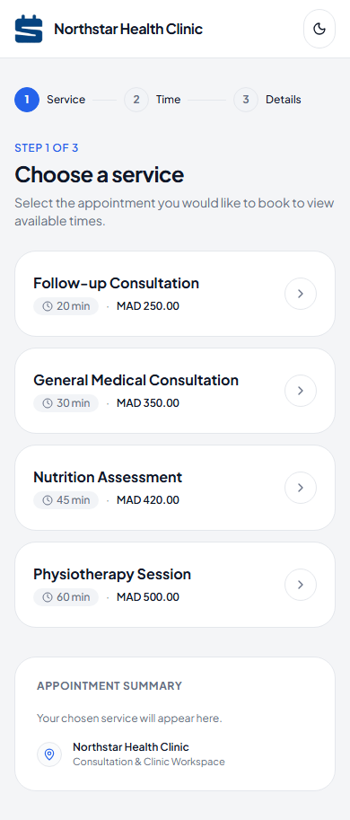 | 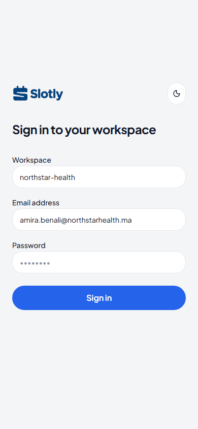 | 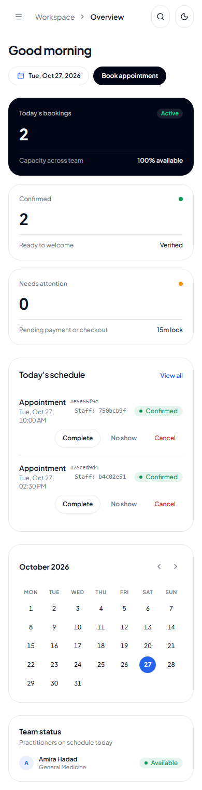 |

</div>

---

## ✨ Features at a Glance

- **Multi-Tenancy with Defense-in-Depth**:
  - Partitioned by `tenant_id` across all database entities.
  - Automatic resolution via signed JWT claims, `X-Tenant-Id` GUID, `X-Tenant` slug, or tenant subdomains.
  - EF Core Global Query Filters automatically scope all queries.
  - Write-time interception stamps tenant keys and rejects foreign entities.
  - PostgreSQL composite foreign keys enforce relational database-level tenant constraints.
- **Zero Double-Booking Guarantee**:
  - Three-tier defense: application availability engine, entity version optimistic concurrency, and a **PostgreSQL GiST exclusion constraint** (`slotly_bookings_no_overlap`).
  - Tested under high-contention k6 race conditions with **100% prevention of overlapping bookings**.
- **Daylight-Saving-Aware Availability Engine**:
  - Computes available slots across weekly hours, breaks, buffer times, and staff time off.
  - Handles timezone offsets and daylight saving transitions seamlessly.
- **Real-Time Availability Updates**:
  - SignalR WebSocket groups broadcast slot changes instantly to connected clients upon confirmation, reschedule, or cancellation.
  - ASP.NET Core `HybridCache` (L1 in-memory + optional Redis L2) delivers sub-25ms availability search responses.
- **Transactional Outbox & Reliable Background Jobs**:
  - Lifecycle events persist to an outbox table within the booking database transaction.
  - Hangfire background processors deliver idempotent HTML/text email notifications via Mailpit / SMTP.
- **Stripe Checkout Test Payments**:
  - Configurable deposit percentages or full online payments per service.
  - Cryptographically signed, idempotent Stripe webhook handler.
- **Accessible, Responsive Frontend (`slotly-web`)**:
  - React 19, TypeScript strict, Vite, Tailwind CSS v4, and Radix UI / shadcn/ui.
  - 100% type safety generated from OpenAPI Swagger contracts (`openapi-typescript`).
  - Perfect **100 / 100 Lighthouse Accessibility & Best Practices** scores.
  - Light and dark theme tokens with WCAG AA compliant contrast ratios.

---

## 🛠️ Technology Stack

| Layer | Technologies |
| :--- | :--- |
| **Backend API** | .NET 10 (LTS), C# 13, ASP.NET Core Minimal APIs, Clean Architecture |
| **Data & Persistence** | PostgreSQL 16 (Npgsql), Entity Framework Core 10, snake_case mapping, GiST constraints |
| **Background Processing** | Hangfire with PostgreSQL storage, Transactional Outbox pattern |
| **Realtime & Caching** | SignalR, Microsoft.Extensions.Caching.HybridCache, optional Redis L2 |
| **Security & Auth** | ASP.NET Core Identity, JWT Bearer tokens, SHA-256 rotating refresh tokens, rate limiting |
| **Payments & Mail** | Stripe.net SDK, Mailpit (local SMTP container), MailKit |
| **Frontend Web** | React 19, TypeScript strict mode, Vite, TanStack Query, React Hook Form + Zod, Tailwind CSS v4, Radix UI, FullCalendar |
| **API Client** | Typed client generated via `openapi-typescript` and `openapi-fetch` |
| **Testing** | xUnit, FluentAssertions, Testcontainers (PostgreSQL), Vitest, React Testing Library, Playwright, Grafana k6 |
| **DevOps & Containers** | Docker, Docker Compose, GitHub Actions (CI, CodeQL, GHCR, Releases), Alpine Nginx |

---

## 🏗️ Architecture & System Design

Slotly strictly adheres to **Clean Architecture**. Dependencies point inward toward the Domain model:

```text
       +---------------------------------------------+
       |                  Api Host                   |
       |  (Minimal APIs, SignalR Hubs, Rate Limiter) |
       +----------------------+----------------------+
                              |
       +----------------------v----------------------+
       |               Infrastructure                |
       | (EF Core, Npgsql, Hangfire, Mailpit, Stripe)|
       +----------------------+----------------------+
                              |
       +----------------------v----------------------+
       |                Application                  |
       |     (Use Cases, Validators, Interfaces)     |
       +----------------------+----------------------+
                              |
       +----------------------v----------------------+
       |                   Domain                    |
       | (Entities, Value Objects, Domain Events)    |
       +---------------------------------------------+
```

### System Architecture Diagram

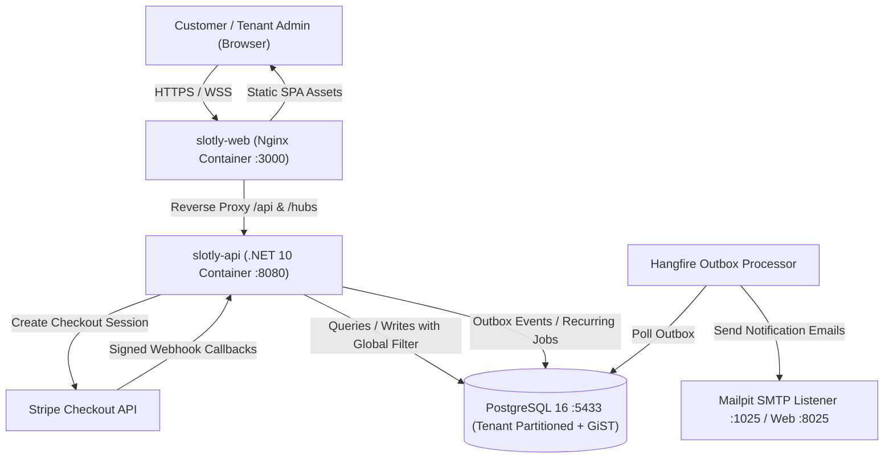

### Booking Creation & Concurrency Sequence

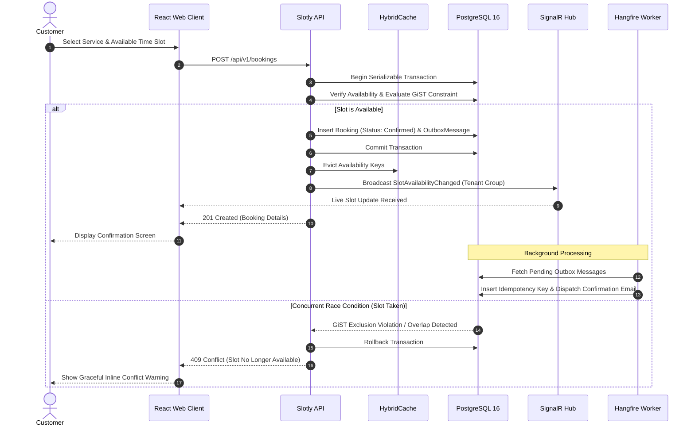

---

## 🚀 Quick Start

Generate unique local credentials, then start the complete local infrastructure:

```powershell
./scripts/initialize-environment.ps1
docker compose --env-file .env -f docker/compose.yml up --build --detach --wait
```

The generator creates the ignored `.env` and `src/slotly-web/.env.local` files.
It refuses to overwrite them unless `-Force` is supplied explicitly.

### Local Endpoints

| Service | URL | Description |
| :--- | :--- | :--- |
| **Customer Booking Demo** | <http://localhost:3000/book/northstar-health> | Public booking flow for Northstar Health Clinic |
| **Tenant Admin Portal** | <http://localhost:3000/login> | Admin sign-in (`amira.benali@northstarhealth.ma` / `Password123!`) |
| **API Swagger UI** | <http://localhost:8080/swagger> | Interactive OpenAPI specification and test console |
| **API Health / Readiness** | <http://localhost:8080/health/ready> | Deep health check (DB, Hangfire, SMTP) |
| **Mailpit Web UI** | <http://localhost:8025> | Local email inbox catching booking confirmations |
| **Hangfire Dashboard** | <http://localhost:8080/hangfire> | Background job monitor (requires PlatformAdmin) |
| **Seq** | <http://localhost:8081> | Structured application logs |
| **Redis** | `localhost:6379` | HybridCache distributed cache |
| **PostgreSQL** | `localhost:5433` | Unique credentials generated in the ignored `.env` file |

To tear down the stack and clean local volumes:
```bash
docker compose --env-file .env -f docker/compose.yml down --volumes
```

---

## ⚙️ Environment Configuration

Configuration is supplied by the ignored real `.env` files. There are no
runtime sample fallbacks: Compose and the API fail with the missing variable's
name. [.env.example](.env.example) and
[src/slotly-web/.env.example](src/slotly-web/.env.example) document the required
names with fake values.

| Variable | Description | Default | Required in Production |
| :--- | :--- | :--- | :---: |
| `POSTGRES_DB` | PostgreSQL database name | Generated locally | Yes |
| `POSTGRES_USER` | PostgreSQL application user | Generated locally | Yes |
| `POSTGRES_PASSWORD` | PostgreSQL user password | Generated locally | Yes |
| `POSTGRES_PORT` | Host port mapped to PostgreSQL | `5433` | No |
| `API_PORT` | Host port exposed by the API container | `8080` | No |
| `WEB_PORT` | Host port exposed by the Web container | `3000` | No |
| `JWT_SIGNING_KEY` | Secret key for signing JWT tokens (min 32 chars) | Generated locally | **Yes** |
| `JWT_ISSUER` | Validated JWT token issuer claim | Configured locally | Yes |
| `JWT_AUDIENCE` | Validated JWT token audience claim | Configured locally | Yes |
| `JWT_ACCESS_TOKEN_LIFETIME_MINUTES` | Access token lifespan in minutes | `15` | No |
| `JWT_REFRESH_TOKEN_LIFETIME_DAYS` | Refresh token lifespan in days | `7` | No |
| `TENANCY_BASE_DOMAIN` | Base domain for tenant subdomain routing | `slotly.local` | Yes |
| `TENANCY_ENABLE_SUBDOMAIN_RESOLUTION`| Enable tenant extraction from host subdomain | `true` | No |
| `TENANCY_ENABLE_HEADER_RESOLUTION` | Enable `X-Tenant` / `X-Tenant-Id` headers | `true` | No |
| `RATE_LIMIT_TENANT_API` | Per-minute request limit for tenant reads | `120` | No |
| `RATE_LIMIT_TENANT_WRITE` | Token bucket limit for booking writes | `80` | No |
| `SMTP_HOST` | Hostname of SMTP mail provider | `mailpit` | Yes |
| `SMTP_CONTAINER_PORT` | Port of SMTP mail provider | `1025` | Yes |
| `SMTP_USE_SSL` | Enable TLS/SSL connection for mail | `false` | Yes |
| `SMTP_USERNAME` | SMTP authentication username | — | If auth enabled |
| `SMTP_PASSWORD` | SMTP authentication password | — | If auth enabled |
| `STRIPE_SECRET_KEY` | Stripe test API secret key (`sk_test_...`) | — | For payments |
| `STRIPE_WEBHOOK_SECRET` | Stripe webhook signing secret (`whsec_...`) | — | For webhooks |
| `REDIS_CONNECTION_STRING` | Redis connection string for L2 cache | `redis:6379` locally | Yes |
| `SEQ_URL` | Seq structured-log ingestion URL | `http://seq:5341` locally | Yes |
| `VITE_API_URL` | Browser-visible API origin (frontend `.env.local`) | `http://localhost:8080` locally | Yes |

---

## 🧪 Comprehensive Testing Guide

Slotly maintains 100% test automation covering domain logic, integration isolation, frontend components, end-to-end browser journeys, and load capacity:

```bash
# 1. Run Backend Unit & Integration Tests (including Testcontainers PostgreSQL)
dotnet test Slotly.sln --configuration Release

# 2. Run Frontend Code Checks (Lint, TypeScript, Vitest)
cd src/slotly-web
npm ci
npm run lint
npm run typecheck
npm test

# 3. Run Playwright End-to-End Browser Journeys (Against Running Stack)
npm run test:e2e

# 4. Run k6 Load & Concurrency Benchmark
Get-Content scripts/load-test.js -Raw | docker run --rm -i --network=slotly_default grafana/k6 run -
```

### Test Coverage Highlights
- **Domain Tests** (`tests/Slotly.Domain.Tests`): 36 unit tests validating entity invariants, lifecycle state machines, daylight saving offsets, and overlap rules.
- **Application Tests** (`tests/Slotly.Application.Tests`): 25 unit tests covering FluentValidation request rules and availability calculations.
- **Integration Tests** (`tests/Slotly.Api.IntegrationTests`): 27 integration tests running real PostgreSQL instances via **Testcontainers** verifying tenant boundary leaks, JWT refresh reuse detection, concurrent bookings, and transactional outbox idempotency.
- **E2E Tests** (`src/slotly-web/e2e`): 7 Playwright browser journeys verifying booking completion, admin dashboard actions, and visual regression baselines.
- **k6 Load Tests** (`scripts/load-test.js`): Verified **13,412 requests** at 334+ req/sec with sub-25ms cached responses and **0 double bookings**. See [docs/performance.md](docs/performance.md).

---

## 📁 Project Directory Structure

```text
.
├── .github/                   # Workflows (CI, CodeQL, Release, Container Publishing)
├── docker/                    # Dockerfiles (API, Web, Demo) and Compose configurations
├── docs/                      # Architectural Decision Records (ADRs) and guides
│   ├── adr/                   # Architecture Decision Records (0001–0006)
│   ├── api.md                 # REST API reference and endpoint documentation
│   ├── architecture.md        # Architecture and entity relationship models
│   ├── deployment.md          # Cloud deployment guide and free hosting evaluation
│   ├── design-system.md       # Visual tokens, accessible components, and theme rules
│   ├── performance.md         # k6 benchmark metrics and latency percentiles
│   └── screenshots/           # Visual baselines (light/dark, mobile/desktop)
├── scripts/                   # Load testing scripts and PowerShell automation
├── src/
│   ├── Slotly.Domain/         # Scheduling domain entities, value objects, domain events
│   ├── Slotly.Application/    # Use cases, validation, interfaces, availability engine
│   ├── Slotly.Infrastructure/ # EF Core DbContext, Npgsql mappings, Hangfire, Mailpit
│   ├── Slotly.Api/            # Minimal API endpoints, SignalR hubs, JWT & rate limiting
│   └── slotly-web/            # React 19 SPA, Tailwind CSS v4, TanStack Query, Radix UI
├── tests/
│   ├── Slotly.Domain.Tests/   # Domain unit tests
│   ├── Slotly.Application.Tests/ # Application and validator unit tests
│   └── Slotly.Api.IntegrationTests/ # Real database Testcontainers integration tests
├── .env.example               # Template of all environment variables
├── CHANGELOG.md               # Versioned changelog following Keep a Changelog
├── LICENSE                    # MIT License
└── README.md                  # Project documentation root
```

---

## ☁️ Free Cloud Deployment & Demo Hosting

Slotly is engineered to deploy seamlessly on free cloud infrastructure without code modifications:

- **Hosting Target**: [Render.com](https://render.com) (Free Web Service) or [Fly.io](https://fly.io)
- **Database**: [Neon.tech](https://neon.tech) (Free Serverless PostgreSQL 16)
- **Single Demo Container**: Uses `docker/Dockerfile.demo` where the ASP.NET Core process hosts both the compiled React SPA static files and the API endpoints, with in-memory HybridCache and auto-migration on boot.

### Cold-Start Behavior & Free Tier Limits
- **Render Web Service**: Spins down to 0 instances after 15 minutes of inactivity. Initial cold-start request takes **~45–50 seconds** to provision compute and boot .NET 10. Subsequent requests respond in **< 30 ms**.
- **Neon Serverless PostgreSQL**: Auto-suspends after 5 minutes of idle time; wakes up in **~500 ms** on incoming connection.
- Detailed step-by-step instructions and configuration flags are documented in [docs/deployment.md](docs/deployment.md).

---

## 🗺️ Product Roadmap

- [x] **Core Architecture**: Solution architecture, repository foundation, central package management.
- [x] **Multi-Tenancy & Data**: Domain models, PostgreSQL schema, tenant isolation, seed data.
- [x] **Authentication & Security**: JWT authentication, rotating refresh tokens, lockout protection, security headers.
- [x] **Availability Engine**: Real-time slot calculation, PostgreSQL GiST exclusion constraint for zero double-booking.
- [x] **Background Jobs & Outbox**: Hangfire background jobs, transactional outbox pattern, idempotent email delivery.
- [x] **Stripe Integration**: Stripe Checkout, customizable deposit policies, secure webhook processing.
- [x] **Realtime & Caching**: SignalR live availability broadcasts, HybridCache L1/L2 caching, rate limiting.
- [x] **Web Experience**: Modern React 19 SPA, OpenAPI TypeScript integration, responsive light/dark themes.
- [x] **Hardening & Quality**: k6 concurrency benchmarks, architecture decision records (ADRs), CI/CD pipelines.
- [ ] **v1.1.0** *(Upcoming)*: Multi-location tenant support, Google / Outlook calendar two-way sync, custom SMS reminders via Twilio.

---

## 📄 License

This project is licensed under the terms of the [MIT License](LICENSE).
