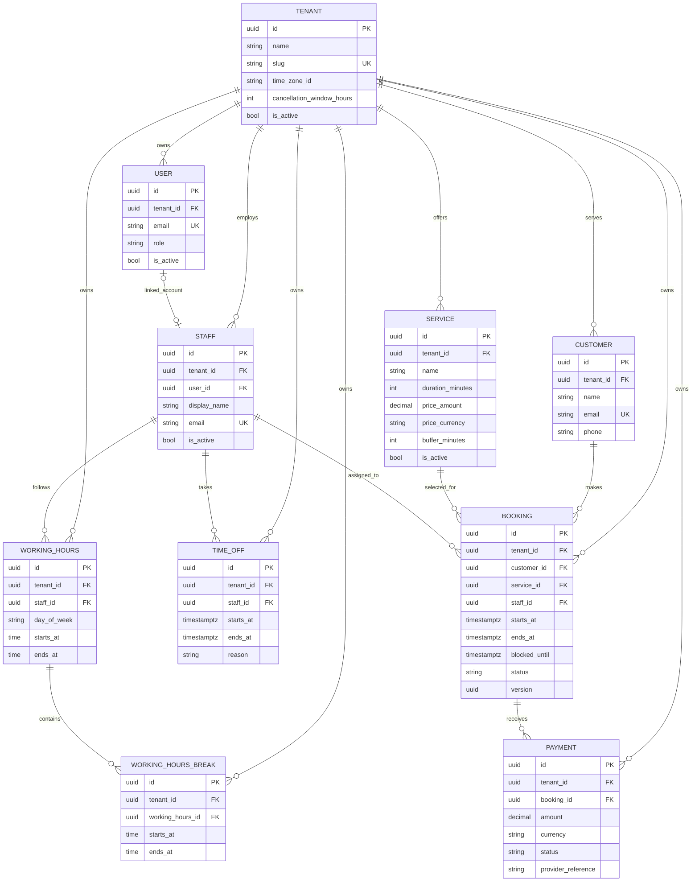

# Architecture

## Dependency direction

Slotly follows Clean Architecture. Dependencies point inward:

```text
Api -> Infrastructure -> Application -> Domain
 |                              |
 +------------------------------+
```

- **Domain** owns entities, value objects, invariants, and state transitions.
- **Application** defines use cases and boundary abstractions such as
  `ITenantContext`.
- **Infrastructure** implements persistence and other external concerns.
- **Api** is the composition root and HTTP boundary.

## Tenant isolation

Every tenant-owned entity carries `TenantId`. The tenant boundary is enforced
in several layers:

1. The API resolves `X-Tenant-Id` into a scoped tenant context.
2. EF Core global query filters automatically scope reads for every
   tenant-owned entity.
3. `SaveChanges` stamps the active tenant on new rows and rejects modified or
   deleted rows whose original or current tenant differs from the active one.
4. Composite foreign keys include `tenant_id`, preventing relationships from
   pointing at another tenant's records even if application checks are bypassed.

Authenticated requests resolve the tenant from the signed JWT claim and reject
a conflicting tenant header or subdomain. Endpoints that do not access tenant
data, such as `/health`, remain available without a tenant context.

## Persistence approach

Application code uses EF Core through focused application-layer boundaries when
a use case needs one. Slotly does not add a generic repository or a second unit
of work: `DbContext` already implements those patterns, and wrapping all of its
query capabilities would add indirection without protecting a domain boundary.
Use-case-specific ports can be introduced when they provide a meaningful seam
for business logic or an external dependency.

PostgreSQL identifiers use snake_case. Domain value objects remain outside the
database model; their scalar backing fields are mapped with Fluent API. Booking
uses an application-managed UUID concurrency token that changes on every
update.

## Entity relationship model



All entities also have `created_at` and `updated_at` audit timestamps. Uniqueness
for tenant-owned records is scoped by `tenant_id`.

Booking overlap is also enforced in PostgreSQL by a partial GiST exclusion
constraint over tenant, staff, and the `[starts_at, blocked_until)` range. See
[booking-engine.md](booking-engine.md) for availability and concurrency details.
